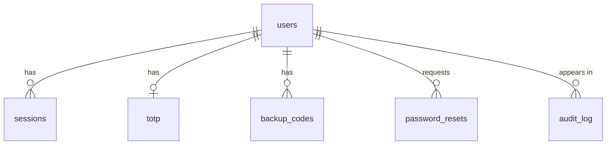
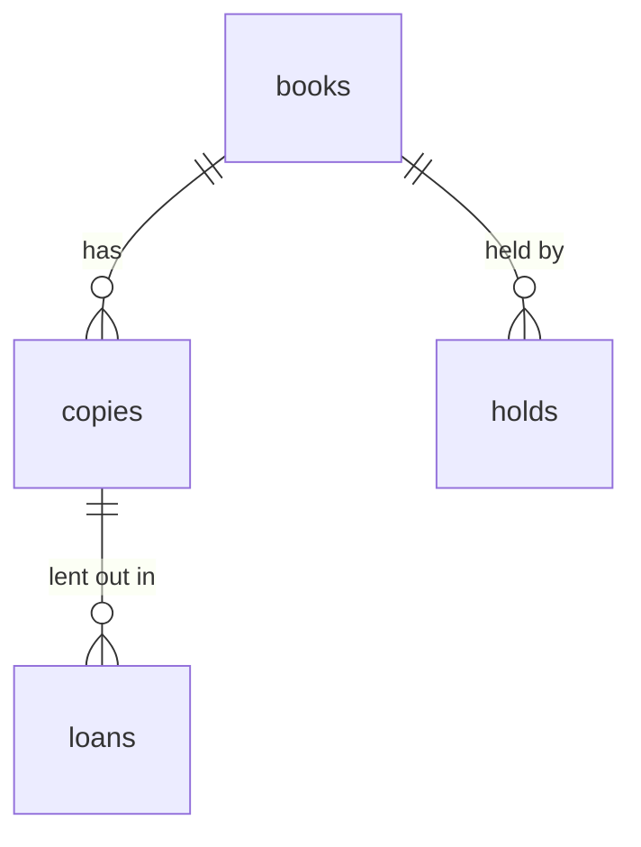

# Data model

The tables in each database, the rules the database enforces, and the decisions behind them.

Two databases, one per service that stores data. Neither service can reach the other's database. Where the library refers to a user, it stores the user's ID only, with no foreign key across databases.

## Conventions

- IDs are UUIDs (`gen_random_uuid()`).
- Times are `timestamptz`, stored in UTC.
- Tables change only through migrations in each service's `migrations/` folder.

## Users DB (auth-service)

### users

| Column | Type | Notes |
| --- | --- | --- |
| id | uuid, primary key | |
| email | text, not null | Unique, compared in lower case; used to sign in |
| name | text, not null | |
| phone | text, null | |
| role | text, not null, default `member` | `member`, `librarian` or `admin` |
| password_hash | text, not null | argon2id |
| is_active | boolean, not null, default true | False when an admin disables the account |
| created_at | timestamptz, not null | |
| updated_at | timestamptz, not null | |

### sessions

One row per refresh token.

| Column | Type | Notes |
| --- | --- | --- |
| id | uuid, primary key | |
| user_id | uuid, not null | References `users` |
| family_id | uuid, not null | Shared by every token from one sign-in |
| token_hash | bytea, not null, unique | SHA-256 of the refresh token |
| user_agent | text, null | For the active sessions page |
| created_at | timestamptz, not null | |
| last_used_at | timestamptz, not null | |
| expires_at | timestamptz, not null | |
| revoked_at | timestamptz, null | |

### totp

| Column | Type | Notes |
| --- | --- | --- |
| user_id | uuid, primary key | References `users` |
| secret_encrypted | bytea, not null | Encrypted, key held in Secret Manager |
| confirmed_at | timestamptz, null | Set once the first code is verified |

### backup_codes

| Column | Type | Notes |
| --- | --- | --- |
| id | uuid, primary key | |
| user_id | uuid, not null | References `users` |
| code_hash | text, not null | argon2id |
| used_at | timestamptz, null | |

### password_resets

| Column | Type | Notes |
| --- | --- | --- |
| id | uuid, primary key | |
| user_id | uuid, not null | References `users` |
| token_hash | bytea, not null, unique | SHA-256 of the reset token |
| created_at | timestamptz, not null | |
| expires_at | timestamptz, not null | 15 minutes after creation |
| used_at | timestamptz, null | |

### audit_log

| Column | Type | Notes |
| --- | --- | --- |
| id | bigint, identity, primary key | |
| actor_id | uuid, null | Who did it |
| action | text, not null | e.g. `login.failure`, `role.change` |
| target_id | uuid, null | Who it was done to |
| details | jsonb, null | No passwords, tokens or personal details |
| created_at | timestamptz, not null | |

## Library DB (library-service)

### books

| Column | Type | Notes |
| --- | --- | --- |
| id | uuid, primary key | |
| title | text, not null | |
| author | text, not null | |
| genre | text, null | |
| publication_year | integer, null | |
| isbn | text, null, unique | |
| cover_object | text, null | Random object name in the cover bucket |
| search_vector | tsvector, generated | Title and author, GIN index |
| created_at | timestamptz, not null | |
| updated_at | timestamptz, not null | |

### copies

| Column | Type | Notes |
| --- | --- | --- |
| id | uuid, primary key | |
| book_id | uuid, not null | References `books` |
| barcode | text, not null, unique | |
| status | text, not null, default `available` | `available`, `on_loan`, `on_hold` or `withdrawn` |
| created_at | timestamptz, not null | |

### loans

| Column | Type | Notes |
| --- | --- | --- |
| id | uuid, primary key | |
| copy_id | uuid, not null | References `copies` |
| member_id | uuid, not null | User ID from auth-service |
| issued_by | uuid, not null | The member, or the librarian for a desk checkout |
| borrowed_at | timestamptz, not null | |
| due_at | timestamptz, not null | |
| returned_at | timestamptz, null | |
| returned_by | uuid, null | Librarian who recorded the return |

### holds

| Column | Type | Notes |
| --- | --- | --- |
| id | uuid, primary key | |
| book_id | uuid, not null | References `books` |
| member_id | uuid, not null | User ID from auth-service |
| placed_at | timestamptz, not null | |
| ready_at | timestamptz, null | |
| expires_at | timestamptz, null | 3 days after `ready_at` |
| closed_at | timestamptz, null | Fulfilled, cancelled or expired |

## Rules the database enforces

| Rule | How |
| --- | --- |
| A copy is on at most one active loan | Unique index on `loans(copy_id)` where `returned_at is null` |
| A member holds a book at most once at a time | Unique index on `holds(book_id, member_id)` where `closed_at is null` |
| One account per email | Unique index on `lower(users.email)` |
| Role and status values are valid | `CHECK` constraints |
| Due date is after borrow date | `CHECK (due_at > borrowed_at)` |
| Audit rows cannot be changed | No `UPDATE` or `DELETE` grant on `audit_log` |

## Deleting an account

1. auth-service deletes the user row; sessions, 2FA, backup codes and reset tokens go with it.
2. library-service cancels open holds. Deletion is refused while a loan is active.
3. Loans stay, keyed by an ID that no longer points to anyone.

## Design decisions

1. **Random IDs instead of counting numbers.** Counting IDs can be guessed, and the original project's two separate counters collided and let a member pass a librarian check.
2. **Copies are separate from books.** A library can own several copies of one book; availability is the number of available copies.
3. **Secrets are hashed unless they must be read back.** Passwords, refresh tokens, reset tokens and backup codes are hashed. The 2FA secret is the one exception: it is encrypted, because codes are checked by recalculating them from the secret.
4. **Email is the only sign-in identifier.** No separate username to leak or enumerate.
5. **Every loan records who issued it,** so desk checkouts can be traced back to the librarian.
6. **The audit log is append-only.** Even with control of auth-service, an attacker can't edit or delete the record of what they did.
